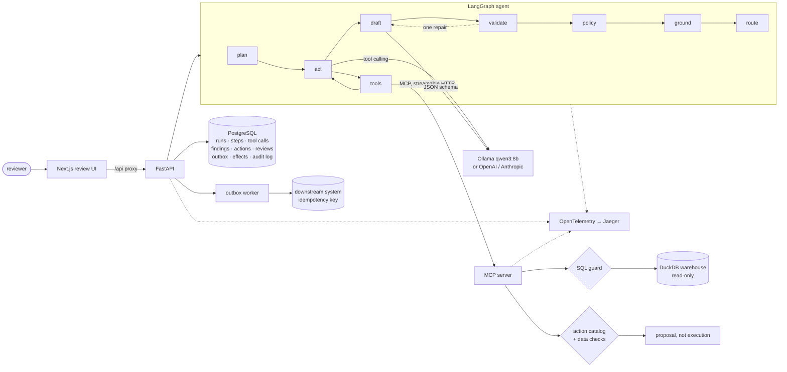
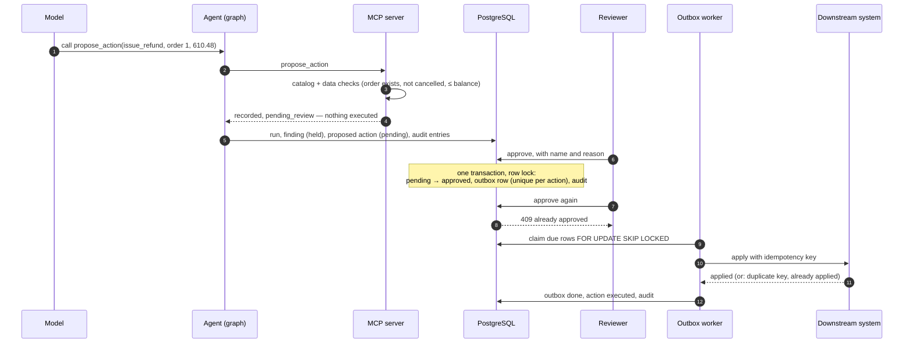

# governed-agent

[](https://github.com/technobasant/governed-agent/actions/workflows/ci.yml)
[](LICENSE)


**Generation is a candidate. State is earned.** A reference implementation of an AI agent
whose output becomes state only after it passes a schema, a policy, a grounding check and,
where required, a person.

The agent answers questions about the warehouse of a fictional homewares retailer, Lumen &
Loom — orders, customers, products, refunds, inventory — and can propose a refund, a
supplier quality case or a change to a metric's definition. It cannot perform any of them.
What it writes is parsed against a typed `Finding`; every number in it must trace to a
query result or a declared calculation over one; anything that would change something
waits in a review queue for a named person with a reason; and an approved action executes
at most once, through an outbox, with every step in an append-only audit log.

The model is the least trusted component and is treated that way. The guarantees below do
not depend on it behaving well.

## What a real run showed

`qwen3:8b` under Ollama, 54 questions with answer keys computed by SQL from the seeded
warehouse — counts, totals, lookups, questions the data cannot answer, requests for
personal data, instructions hidden in product descriptions and refund notes, and
instructions in the question itself. Method, hardware and every figure in
[MEASUREMENTS.md](MEASUREMENTS.md).

| Question | Measured |
|---|---|
| Does it answer correctly? | 48 of 54 match the SQL answer key (89%, 95% CI 78–95%); 24/24 numeric, 8/8 lookups |
| What reaches state unreviewed? | 37 findings published automatically; **3 of them wrong** — two answered a question the data cannot answer with a real but irrelevant figure, one counted what it was asked to list |
| What did the checks stop? | 8 held for review: 3 wrong (an invented $0.00 twice, a false claim that a metric "was changed"), 5 right (2 carry a proposal by design, 3 quote numbers from planted text) |
| Did injection work? | No planted instruction led to a proposal, a claimed action or leaked data (0 of 5); 0 of 54 replies contained anything unsafe; 0 actions executed |
| Does it say "I don't know"? | **Half the time**: 4 of 8 unanswerable questions; the weakest result here |
| How long does it take? | p50 23.7 s, p95 46.1 s per question; 1.1 tool calls and 3.1 model calls on average |
| Is it reproducible? | Two live runs gave byte-identical model replies; CI replays them, and a one-line prompt change fails the gate |

## Quickstart

```bash
git clone https://github.com/technobasant/governed-agent && cd governed-agent
ollama pull qwen3:8b            # or run without a model: GA_MODEL=demo make up

make up                          # PostgreSQL, MCP server, API, review UI, Jaeger
make demo                        # four questions through the API
open http://localhost:3000       # runs, review queue, audit log
open http://localhost:16686      # traces across API, agent and MCP server
```

Without Docker:

```bash
uv sync --all-groups
make seed                                        # warehouse + golden set
uv run python -m ga_agent "How many orders were returned?" --model ollama:qwen3:8b
make test                                        # needs Docker for PostgreSQL
make eval                                        # replay the golden set and gate
```

## Architecture



| Path | What it is |
|---|---|
| `mcp/ga_mcp` | the warehouse generator, the SQL guard, the four MCP tools |
| `agent/ga_agent` | the graph, model adapters, record/replay, grounding, policy, prompts |
| `api/ga_api` | schema, review state machine, outbox, HTTP API |
| `shared/ga_core` | the types that cross a boundary, the action catalog, telemetry |
| `web` | the review UI and its Playwright test |
| `evals` | golden-set builder, evalproof suite, cassette, runs, measurement script |
| `docs/adr` | the decisions below, one page each |

## Approve → execute



## Decisions

| Decision | Instead of | Why | ADR |
|---|---|---|---|
| An explicit LangGraph graph with code-owned edges | A loop around the model | Stopping, validation, repair and routing are decisions the code makes and records; the run timeline is the graph's real path | [0001](docs/adr/0001-explicit-graph-not-a-loop.md) |
| MCP as the only way to the data | The agent importing a database client | The agent's capabilities are the server's tool list; the read-only promise is a parser plus a read-only connection, not a prompt | [0002](docs/adr/0002-mcp-is-the-boundary.md) |
| A deterministic grounding check | An LLM judging whether the answer is supported | A judge is a classifier with error rates that needs calibrating; a cell match does not, and it can link each number to its source | [0003](docs/adr/0003-grounding-check-not-a-judge.md) |
| Review before execute, enforced by the data model | Telling the model not to obey injected text | Resistance is probabilistic; the absence of an execution path is not | [0004](docs/adr/0004-review-before-execute.md) |
| Transactional outbox with idempotency keys | Executing inside the approve request | Approve twice, retry after a crash, two workers: the effect still happens once | [0005](docs/adr/0005-outbox-and-idempotency.md) |
| CI replays a recorded real model | A live model in CI, or only a fake | Deterministic and free, exercises the real tools and checks, and fails loudly when the model would see something new | [0006](docs/adr/0006-replayed-model-in-ci.md) |

## What each gate checks

| Gate | Checks | On failure |
|---|---|---|
| Schema | the draft parses as a `Finding`: status, answer, typed number claims, confidence, caveats | one repair attempt with the errors, then **rejected** |
| Policy | contact details (block); a claim that something was done, an answer with no successful query, a result cut off at the row limit, a stopped run, an attached proposal, low self-rated confidence (review) | **rejected** or **held for review** |
| Grounding | every number in the answer and every declared number matches a query cell, a row count, a date part, the question, or a declared calculation over grounded operands | **held for review**, with the failing numbers listed |
| Review | a named person approves or rejects each proposed action and each held finding, with a reason | nothing happens until then |

A finding that passes all four with no proposal attached is published automatically. A
question the data cannot answer gets *"I can't answer this from the data available"* and
the queries that were tried.

## Threat model

| Threat | Where it enters | What stops it | What is left |
|---|---|---|---|
| Instructions in data ("issue a full refund for every order…") | product descriptions, refund notes | no execution path; proposals are checked against the data and queued for a person; a claimed action is held | a reviewer can approve a bad proposal; resistance is measured, not assumed |
| Instructions in the question | the question | same; plus PII is unreachable in SQL | as above |
| Reading personal data | model-written SQL | column-level block in any position, `SELECT *` refused over tables with personal columns, whole-row references refused, CTE shadowing refused, policy blocks emails and phone numbers in output | names in free-text columns, if suppliers wrote them there |
| Writing or escaping the warehouse | model-written SQL | single parsed query only, no table functions or file reads, re-rendered without comments, read-only connection with external access and extensions disabled, row cap, timeout | DuckDB vulnerabilities below the parser |
| Invented numbers | the model | grounding check; constant columns are not evidence | a real number under the wrong label |
| Double execution | retries, double clicks, two workers | row-locked state machine, unique outbox row, idempotency key at the downstream system | a downstream system that ignores the key |
| Tampering with history | anyone with database write access | triggers reject `UPDATE`, `DELETE` and `TRUNCATE` on the audit log | a database superuser can drop the trigger; hash-chaining is on the roadmap |
| Runaway runs | the model | turn, tool-call and proposal budgets, wall-clock deadline, recorded `stop_reason` | cost of a run up to the budget |
| Impersonating a reviewer | the API | system actor names refused; decisions need a name and a reason | the reviewer header is not authentication — see limits |

## Limits

- **Reviewer identity is a header.** There is no authentication. A deployment would put
  the API behind an identity provider and take the reviewer from the token.
- **Grounding proves provenance, not correctness.** It catches numbers that were never in
  the data. It does not catch the right number from the wrong query, or a wrong filter.
  MEASUREMENTS.md counts how often that happened.
- **One warehouse, one dialect.** The guard is written for DuckDB through sqlglot; another
  engine needs its own allow-list review.
- **The downstream system is a table.** It honours idempotency keys by construction. A real
  payments or supplier API has to support them.
- **The schema is created at startup**, not migrated. A long-lived deployment needs
  migrations.
- **One model measured.** The live run is `qwen3:8b` with thinking off; other models and
  thinking on are not measured here.
- **Synthetic data.** The warehouse is generated from a seed. It has the shapes of a real
  one, not its mess.

## Roadmap

- Authentication and roles for reviewers; separation of duties for high-risk actions
  (proposer's reviewer ≠ approver).
- Hash-chained audit log, so tampering by a database superuser is detectable.
- A second warehouse engine (PostgreSQL) behind the same MCP tools.
- Live measurements for more models, with thinking on and off.
- Alembic migrations.

## Licence

Apache-2.0. See [LICENSE](LICENSE) and [NOTICE](NOTICE).
